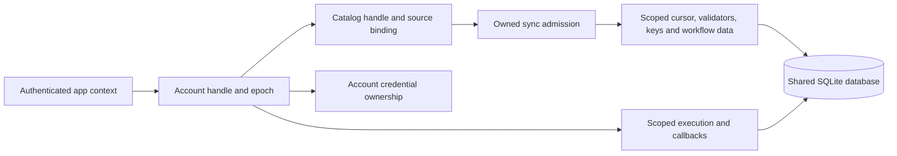

# ADR-0002: Explicit mobile account and catalog scopes

Date: 2026-10-24

Status: the requirement is accepted by the user. Internal account/catalog
identity, session epochs, isolated metadata/signing keys and owner-qualified
workflow cache persistence are implemented;
the remaining API/schema below is a proposed implementation contract. Public
scoped sync and execution are not implemented yet.

## Requirement and current evidence

One engine/database must support multiple signed-in accounts and multiple
workflow catalogs through explicit scopes. Account/catalog identity must remain
stable through credential refresh. Scope selection must be visible at the API
boundary and carried through asynchronous work, storage, callbacks, and recovery.

Current sync metadata, signing-key records, local sequence names, and removal
reconciliation use global mobile state. Existing `mobile/default` storage cannot
prove account/catalog ownership. Token strings, callback addresses, current UI
account, and unverified JWT claims are insufficient stable ownership keys.
DME077/078 add bounded owned sync runs and atomic metadata commits as a shared
foundation. They do not provide scoped ownership.

## Proposed ownership model

The initial internal storage layer uses `mobile_accounts`, `mobile_catalogs`
and `mobile_catalog_metadata`, plus owner-qualified `mobile_catalog_signing_keys`.
Account keys bind immutably to issuer/subject; catalog keys bind immutably to a
stable source descriptor and signing authority.
Descriptors come from trusted host context, not bearer-token parsing. This
storage layer does not itself authenticate remote credentials. Signed ingestion
verifies manifest audiences; the internal private sync path additionally checks a
fresh response from the catalog's immutable trusted identity endpoint.
It exposes no public SDK API and is not connected to legacy sync/execution.

Retirement marks an account inactive. Reopen preserves its ID/data and increments
its durable epoch; exhaustion fails closed. Metadata reads check owner and epoch
in one snapshot. Mutations acquire SQLite's writer reservation with an epoch
predicate before checking catalog membership and committing the entire batch.
Consequently, an admitted transaction settles before retirement, while a write
from an older handle after retirement/reopen is refused across independent
pools. Catalog key replacement uses the same epoch/writer fence, replaces only
the selected catalog's set atomically, and refuses stale/foreign handles even
for an empty set. Legacy tables remain separate, with no implicit adoption.
Catalog manifest acceptance now commits version, original-body digest and keys
atomically. The applied cursor/ETag/environment commit separately after checking
that exact accepted identity under the writer/epoch fence. Pending accepted work
survives reopen and can retry without allowing older versions or changed content
under the same version. Generic catalog metadata writes cannot bypass these
reserved protocol fields. The storage primitives remain internal; the signed
ingestion boundary verifies root signatures and audience fields before accepting
trust. The internal private network caller connects fresh credential/principal
verification before fetching content, as described below.
Workflow storage now maps publisher name/version/source IDs to independently
allocated local engine sequence IDs. Engine rows use the account's local tenant
and catalog namespace; remote tenant/namespace/sub-tenant/embed claims do not
select local owners. The SHA-256 digest covers the original body before those
fields are normalized. A published name/version's source ID and body remain
immutable, including after cache eviction. Definition and mapping writes share
the same transaction, account epoch and accepted-manifest fence.

Active reads by name or local ID enforce owner/epoch in one snapshot. Withdrawal
hides versions from these lookups, deprecates definitions used by nonterminal
instances, and purges unpinned definitions through the engine's normal dependent
row cleanup. Compact identity/withdrawal records remain after cached rows are
deleted. The withdrawing manifest cannot reinstall the same version. A newer
accepted manifest may explicitly reauthorize identical bytes, retaining a pinned
local ID or allocating a new one after purge. These are internal persistence
operations; the caller must still verify signatures, manifest entry identity and
audience before installation. The compact history also needs a storage quota and
explicit owner cleanup policy before public scoped rollout.

The publisher now supports a distinct `orch8.catalog.v1` signed envelope with
source, catalog and explicit public/principal audience fields. Its complete
original body is signed. The internal mobile ingestion path loads the immutable
principal/source/catalog/root binding in one active-owner snapshot and requires
an exact private audience match. Authority pins use `ed25519:<base64 public key>`;
opaque older authority descriptors cannot silently authorize a signed document.
Legacy manifests, unknown/duplicate envelope fields and implicit private-to-public
fallback are refused. Public catalog admission still requires a persisted access
policy and is not exposed yet.

Verified ingestion validates the complete authorized key set and commits it with
the original envelope digest under the existing epoch/replay transaction. The
accepted document handle owns its storage and scope; verified installation checks
the entry hash, detached signature, name/version and current acceptance before
normalizing local IDs. It cannot install after a newer manifest revokes its keys
or its account retires. This is an offline trust boundary, not proof that an
arbitrary bearer token belongs to the declared principal. The internal private
sync caller now adds an authenticated identity response before content fetch,
scoped ETags/replay state, compatibility evaluation and full reconciliation.
Public SDK and scoped execution integration remain required.

The internal [private catalog sync contract](../mobile-catalog-identity.md) pins
identity/manifest endpoints, matches a fresh nonce/principal/source/catalog response,
and retains owner/epoch through verification, installation and metadata writes.
SQLite schema 53 adds immutable transport bindings and accepted entry history.
Workflow version/hash history commits before downloads and refuses rollback or
equivocation even when the earlier download never succeeded. Private I/O uses a
monotonic identity deadline; owned runs retain their account/global operation slots
through dispatched writes. These operation slots do not prove the still-required
physical foreign-callback fairness or total persistent storage quotas.

Public scoped sync/execution, instance/handler ownership, cancellation of running
work, production identity backend integration and SDK handles remain gates.

Durable run admission now stages requests outside `task_instances`. Requests
freeze account/catalog/epoch, chosen definition/version, original creation time,
input identity and the manifest version/digest that authorized admission. Scoped
operation keys deduplicate canonical requests; retries of `latest` retain the
first selection across upgrades. A new login epoch cannot silently reuse an old
operation key. Active handles can inspect prior receipts without rebinding them.

A current reconciliation marker is required before new admission. A completed
accepted/applied cursor is also sufficient evidence for older fully evaluated
caches; a newer pending manifest cannot borrow that readiness. The marker commits
after the removal pass, independently of downloads, so a bad entry does not block
other reconciled cached definitions. Record/input byte caps are checked under the
same writer fence as insertion, with byte-accurate metadata counters and schema
constraints. Retired/cancelled requests remain charged until explicit safe cleanup.
Prepared requests pin definitions; withdrawal deprecates instead of deleting them.

This is durable preparation, not scoped execution. No scheduler instance is
created and a normal engine tick cannot dispatch it. Materialization must first
install frozen handler/credential ownership and enforce account epochs, original
admission context, current publication/capability policy and catalog boundaries
for builtins. Core tenant/sub-tenant checks do not make a catalog namespace alone
a security boundary. Public scoped start/dispatch remains gated on that work.

Use one SQLite database with explicit owner keys and scoped SDK handles. Shared
runtime resources stay bounded across accounts. Scope-specific state is selected
once when creating a handle and retained by every operation from that handle.

| Entity | Stable identity and ownership |
|---|---|
| Account | Internal UUID bound to an explicit app account key and stable principal descriptor; session epochs fence retired handles and callbacks. |
| Catalog | Internal UUID unique within its account, bound to an explicit catalog key, source descriptor, and signing authority. |
| Credential source | Owned by an account/catalog credential binding and epoch, with a separate revision for refresh; a rotated token preserves the owner. |
| Sync run | Owns account/catalog IDs, epochs, source binding, and admission until current storage work settles. |
| Workflow and instance | Immutable account/catalog owner inherited at installation/creation; every lookup and mutation enforces it. |
| Worker/delegation evidence | Retains the account runtime/principal and lease or transfer generation that created it. |

The host supplies the stable authenticated account context. Network principal
binding must be established with a trusted authority response or signed audience
binding before private requests/data are admitted. Opaque tokens and JWTs use
the same verified-principal rule. Merely declaring another account beside a token
must not authorize a scope change. Public catalogs use an explicit public audience
while their local workflow/instance data still belongs to the selected account.

Catalog IDs and private audience/principal claims must be verifiable against the
requested descriptor in scoped manifests. A signed document for another catalog
or account is refused before installation. Endpoint or signing-authority changes
require an explicit rebind; they cannot silently reset the replay fence. A
signature URL query or credential refresh does not create a new catalog.

## Storage and operation boundaries

- Use composite owner keys/foreign keys and parameterized owner predicates for
  catalog metadata, signing keys, installed versions, instances, deduplication,
  approvals, journals, and cleanup. SQLite has no row-level security safety net.
- Qualify physical IDs by owner while verifying the original signed bytes.
  Identical supplied sequence IDs cannot alias another scope's stored version.
- Resolve local sequence names inside the selected account/catalog. Identical
  names and key IDs in independent catalogs must coexist. Scope-specific
  removals, eviction and key rotation cannot touch another catalog.
- Commit each catalog's ETag, replay cursor and evaluation fingerprint together.
  Rollback detection survives restart and endpoint/token rotation.
- Bound total network/callback/database work across the shared runtime and also
  limit work per account. Repeated retirement cannot evade physical admission.
  A stuck account must not consume every other account's callback allowance.
- Retain run ownership through already-dispatched writes. Cancel future phases
  on retirement. Persisted epochs fence late writes across close/reopen and
  process/engine handover; a logical semaphore alone does not prove that case.
- Account close retires credential/callback admission and account-bound workers,
  listeners, approvals and delegation operations. It preserves unresolved effect
  evidence. Reopening requires matching principal identity and a new epoch.
- Handlers receive immutable scope context or an explicitly scope-bound handler
  object. They cannot consult an ambient current account. Sub-sequence and
  delegation resolution enforce the same owner boundary.

## SDK contract and migration

Expose account and catalog handles in Rust/FFI and typed Swift, Kotlin, RN and
Flutter wrappers. Scoped sync, install/start, reads, cancellation, replies,
listeners, worker/delegation and cleanup operations carry the handle's identity.
Apply the same ownership invariants to embedding bindings and public SDK/wire
contracts where they expose these operations. Generated bindings and native
artifacts must be versioned and released together.

Keep old rows in an explicit legacy owner. Never assign ambiguous historical
data to the first newly opened account. Mixed scoped/unscoped private operations
must fail closed after opting into scoped mode. Migration is explicit, validates
ownership, and keeps active instances/unknown effects with their original owner.
No automatic account-wide deletion is authorized by adding this feature.

## Required evidence before claiming scoped support

| Gate | Required behavior |
|---|---|
| S1 | Two accounts and two catalogs each coexist in one database, including identical workflow names, supplied IDs and signing-key IDs. |
| S2 | Sync, removals, revocation and eviction affect only their owner; a malicious cross-scope reference is refused. |
| S3 | ETag, replay/version and handler/SDK evaluation state remain separate and survive reopen. |
| S4 | Refresh preserves stable identity; principal/catalog mismatch is refused before private dispatch or installation. |
| S5 | Controlled overlaps, timeout, cancellation, disk failure and partial writes cannot corrupt another scope or its replay fence. |
| S6 | Closing/reopening an account fences old handles, callbacks, writes, listeners, and queued work without discarding unsettled effects. |
| S7 | Background execution, handlers, approvals and outputs retain scope through UI account changes and app restart. |
| S8 | Node leases, recovery, delegation and handoff preserve their initiating account/principal and generation. |
| S9 | Shared and per-account bounds survive hung callbacks and rapid scope retirement; another account can recover. |
| S10 | Legacy migration neither adopts nor exposes another account's data, including offline and failed-migration cases. |
| S11 | Actual native/FFI and platform runtime tests cover the scoped contract; generated API checks, artifacts and release pins agree. |
| S12 | Completion is audited against the full distributed/mobile/embedded matrix, including supported independent-engine/process cases. |

## Trade-offs and next implementation step

Explicit handles and owner keys add API/schema work and require coordinated SDK
migration. They permit one database/runtime with isolated data and bounded shared
resources. Separate databases and token-hash cache keys do not satisfy the chosen
requirement. Keep the implementation in the current runtime and storage modules;
no extra service, broker, or deployment is required.

The internal private sync caller and durable request admission are implemented.
Next carry immutable owners through actual instance materialization, handler and
builtin dispatch, recovery, listeners and every execution write.
Public handles must not expose partially isolated execution. Keep all gates open
until their complete runtime and SDK evidence exists.
