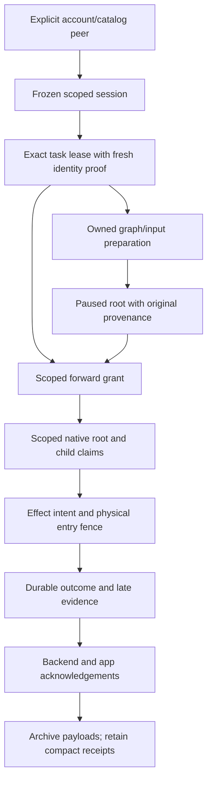

# Scoped remote execution contract

Status: implementation target. Scoped native roots currently initialize paused;
negotiated mobile delegation delivery remains disabled.

The implementation must support multiple accounts and catalogs in one database,
survive device suspension and process restarts, and archive only after app and
backend acknowledgement while retaining compact deduplication/outcome receipts.

## Authority boundaries

| Evidence | Meaning | Required next boundary |
| --- | --- | --- |
| Validated local peer | Explicit account/catalog to backend tenant/runtime association | Fresh device-session identity proof |
| Fresh identity proof | One frozen credential names the expected tenant/runtime/device | Accepted heartbeat for the exact task generation |
| Confirmed lease observer | Conservative live monotonic execution interval | Exact peer/account/catalog/task/generation binding |
| Verified frozen graph/input | Immutable content and request provenance | Runtime policy and scoped execution grant |
| Paused native root receipt | Stable local identity and original ownership | Authorized native claim and writes |
| Native claim/effect intent | Fenced local step dispatch | Final physical provider-entry checks |
| Terminal local outcome | Durable result or explicit ambiguity | Backend acknowledgement and app acknowledgement |

Workflow JSON cannot manufacture these runtime-owned objects. Definition cache
hits, decoded input and read-only peer records do not grant forward execution.
Remote backend tenant identity and local account tenant identity remain distinct.

## Required flow

1. Open a session for one validated peer and current local account/catalog epoch.
   Freeze its device-session credential. Use its fixed API origin, runtime ID and
   expected device; no ambient legacy node client or cross-principal refresh.
2. Validate the complete issued context against the transport task and peer.
   Published v1 mailboxes use attempt **0**. Claim epochs may advance; native
   graph step business attempts remain independent.
3. Obtain a fresh nonce-bound identity proof and accepted heartbeat for that exact
   claim. Mint an opaque typed lease authority bound to peer, account, catalog,
   local epoch, backend tenant, task, worker, claim epoch and issued references.
   A caller cannot pair arbitrary claim metadata with another bare lease observer.
4. Supervise owned preparation and paused initialization under that lease.
   Preserve physical preparation ownership through cancellation, decoding,
   submitted SQL settlement and abandoned-result destruction. Bind the exact
   initialized local run to the prepared identity and original immutable receipt.
5. Validate runtime policy against the captured graph, SDK and explicitly scoped
   handlers/builtins/credential policy. Mint the forward grant only after live
   lease and current scope checks around the final ownership read.
6. Claim and mutate native roots and descendants through explicit scoped storage
   authority. Generic scheduler SQL, legacy mobile access and descriptor-free
   credentials/capsules must continue excluding every remote-owned instance.
   Every child needs durable original-root ownership before it becomes runnable.
7. Resolve root, child, selector, failure/cancel hook and saga compensation
   definitions exclusively from the frozen closure. Mutable catalog lookup cannot
   change a captured invocation. Remote provenance cannot impersonate a signed
   local catalog request.
8. Fence each forward step, credential access, durable effect dispatch and final
   physical provider entry. Recheck after storage/dispatch waits. Lease expiry,
   supersession, account retirement and engine shutdown refuse further entry.
   Graceful worker stop continues draining admitted work.
9. Retain task and logical invocation exclusion until actual callback and foreign
   destructor completion. Logical cancellation and elapsed time do not release
   physical capacity. Bound physical-contention poll/release traffic.
10. Journal starts, known outcomes, ambiguous effects and late physical outcomes.
    Persist a known result even when its original logical observer disappears.
    A stale generation cannot publish a successful result as current work.
11. Resume the same logical root after a new lease or sign-in only under verified
    original ownership. Preserve native step attempts, outputs and effect IDs.
    Waiting/backgrounded workflows need a bounded polling and memory policy;
    rediscovery cannot create a second root or re-run completed provider work.
12. Separate scoped history reads, local answers and cancellation from permission
    to execute. Archive requires the exact terminal outcome, backend acceptance,
    app acknowledgement and physical quiescence. Authorization failures, network
    errors and lease loss are not outcome acknowledgements. Preserve compact
    dedup/outcome evidence and enforce separate payload/history resource budgets.

## Implementation order

### A. Scoped session and claim lease

Add an internal frozen-session transport and opaque scoped claim lease. Tests must
prove wrong tenant/runtime/device, wrong task/generation, retired local scopes,
invalid mailbox attempts, revoked credentials and stopped acquisition cannot mint
authority. Exercise real identity and heartbeat endpoints, frozen authentication,
supervised renewal, direct expiry/supersession and redacted diagnostics.

### B. Native execution and descendant ownership

Introduce the explicit root/descendant claim, write and credential boundaries.
Connect the runtime policy, frozen definition resolver and physically owned
scoped handler dispatcher. Cover child and lifecycle paths, saga compensation,
concurrent engines, mid-await revocation and delayed writer acquisition. Keep
generic access denied even after mutable native row fields change.

### C. Durable lifecycle, archive and SDK delivery

Complete restart/background/waiting recovery, late outcomes, backend reconciliation
and acknowledged archive. Exercise multiple accounts/catalogs, sign-in changes,
quota exhaustion, stale handles, corrupt/future codecs and receipt immutability.
Validate aggregate poll/checkpoint byte bounds and exact full-width mutation
epochs. Run actual Swift, KMP, Flutter, React Native, Node, Python and web
execution/upgrade probes alongside Rust/SQLite/Postgres end-to-end tests. Record
each runtime's supported feature set explicitly. Enable the negotiated capability
only for a runtime whose complete path is verified. Publishing a release remains
a separate action.

## Evidence discipline

The [distributed/mobile review](reviews/2026-10-24-distributed-mobile-embedded.md)
records individual findings, exact source identities, tests and remaining gates.
Dirty-root test counts, isolated-parent test counts and platform CI results have
different scopes. A history-only rebase must preserve the validated tree. Every
merge requires the exact current head's complete CI and Mobile workflows and all
required checks to succeed; preserve all dirty or unmerged work during cleanup.
